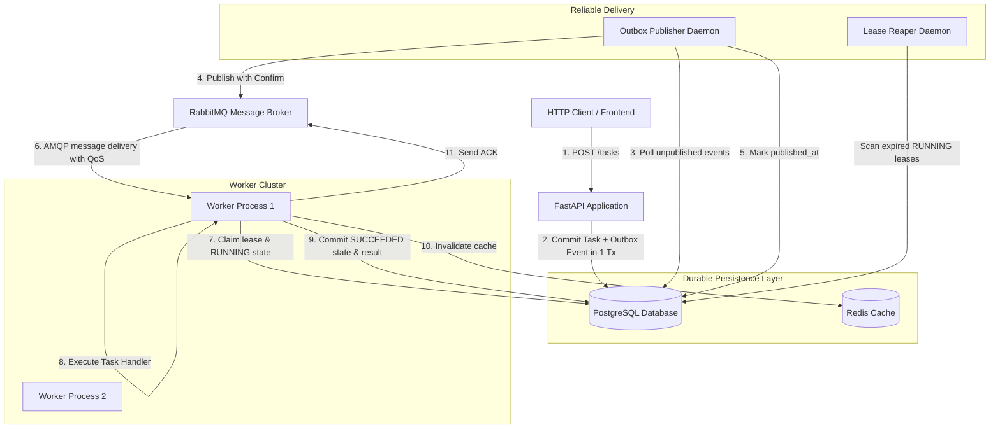

# 01 - Architecture Overview

## 1. What Problem This Module Solves
In modern web applications, performing long-running or computationally expensive tasks (generating reports, processing payment batches, transcoding media, interacting with external third-party APIs) directly within an HTTP request thread blocks the client and degrades web server throughput. 

This distributed task queue decouples request intake from asynchronous execution, enabling horizontal scalability, fault tolerance, and workload smoothing.

## 2. Why the Module Exists
Synchronous request handling introduces three critical failure modes:
1. **HTTP Client Timeouts**: Requests lasting longer than 5–30 seconds are terminated by reverse proxies (e.g. Nginx, Cloudflare, ALB).
2. **Server Starvation**: Web worker threads remain locked waiting on I/O, preventing other incoming traffic from being accepted.
3. **Cascading Failure**: A slow downstream service exhausts API connections, bringing down the entire API gateway.

The Distributed Task Queue decouples submission (fast, durable API response) from execution (asynchronous worker pool).

## 3. Where It Fits in the Distributed Architecture

## 4. Key Components and Responsibilities
- **FastAPI API Layer (`src/taskqueue/api/`)**: Validates input schemas, enforces client submission idempotency, records task state in PostgreSQL, and enqueues outbox events.
- **PostgreSQL Database (`src/taskqueue/database.py`, `models/`)**: Authoritative single source of truth for task status, payloads, attempt histories, and transactional outbox logs.
- **RabbitMQ Message Broker (`src/taskqueue/broker/`)**: High-throughput distributed message exchange providing durable priority queues, publisher confirms, consumer prefetch, and dead-letter exchanges (DLX).
- **Transactional Outbox Publisher (`src/taskqueue/outbox/publisher.py`)**: Guarantees at-least-once message delivery from PostgreSQL to RabbitMQ, preventing data loss when the API or network crashes after database commit.
- **Worker System (`src/taskqueue/services/worker_service.py`)**: Scalable background workers consuming tasks via AMQP, maintaining leases, invoking task handlers, and managing state transitions.
- **Lease Reaper (`src/taskqueue/outbox/reaper.py`)**: Active recovery mechanism that detects abandoned tasks from crashed workers and safely re-queues them.
- **Redis Cache (`src/taskqueue/cache/redis.py`)**: Optional read-through cache for fast status checks. PostgreSQL remains authoritative.

## 5. Topics to Understand Before Studying
1. **Asynchronous I/O (`async`/`await`) in Python**: Coroutines, event loops, tasks, and semaphores.
2. **ACID Transactions**: Why dual writes to a database and a message broker without an outbox pattern are non-atomic.
3. **AMQP Protocol Basics**: Exchanges, queues, bindings, routing keys, message acknowledgments (ACK/NACK).
4. **Optimistic Locking**: Using a version counter column to detect concurrent updates.

