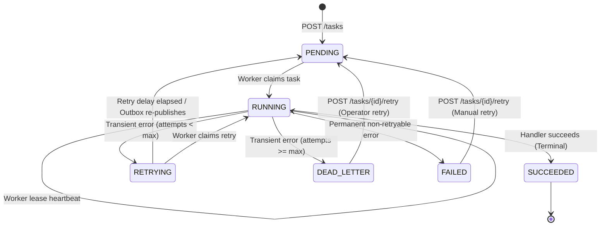

# 02 - Task Lifecycle and State Machine

## 1. What Problem This Module Solves
In a distributed queue, multiple asynchronous actors (API servers, workers, lease reapers, manual operators) interact with task records. Without an explicit, strictly validated state machine, tasks can end up in invalid states (e.g. an already completed task being re-run, or a worker executing a task that was cancelled).

## 2. The Task Lifecycle State Machine

## 3. State Definitions and Ownership
| State | Component Owner | Meaning | Next Valid States |
|---|---|---|---|
| `PENDING` | API / Reaper | Task recorded durably in DB, awaiting broker publication or worker claim. | `RUNNING`, `FAILED` |
| `RUNNING` | Worker | Worker acquired lease and is actively executing handler. | `SUCCEEDED`, `RETRYING`, `FAILED`, `DEAD_LETTER`, `RUNNING` (heartbeat) |
| `RETRYING` | Worker | Execution encountered a transient error; backoff timer scheduled. | `PENDING`, `RUNNING`, `DEAD_LETTER` |
| `SUCCEEDED` | Worker | Business logic completed successfully; results stored. | *(None - Terminal)* |
| `FAILED` | Worker / API | Execution aborted due to permanent fatal error or rejected retry. | `PENDING` (via manual retry endpoint only) |
| `DEAD_LETTER` | Worker / Reaper | Retry attempts exhausted or unrecoverable broker rejection. | `PENDING` (via manual operator retry) |

## 4. Key Classes and Implementation
- `Task` ([src/taskqueue/models/task.py](file:///c:/Users/bhanu/Music/Complete%20Desktop/Distributed_sysstem_project/src/taskqueue/models/task.py)):
  - Contains fields: `id`, `task_type`, `payload`, `status`, `priority`, `attempt_count`, `max_attempts`, `version`, `lease_expires_at`, `created_at`, `started_at`, `completed_at`.
  - `transition_to(target_state)`: Validates transition legality against `ALLOWED_TRANSITIONS`.
- `StateTransitionError` ([src/taskqueue/exceptions.py](file:///c:/Users/bhanu/Music/Complete%20Desktop/Distributed_sysstem_project/src/taskqueue/exceptions.py)):
  - Raised when attempting an illegal transition (e.g., `SUCCEEDED -> RUNNING`).

## 5. Important Design Decisions
1. **Terminal State Protection**: `SUCCEEDED` has no outgoing transitions. Once a task succeeds, no duplicate delivery or stray worker can re-execute it.
2. **Version Increments**: Every call to `transition_to()` increments the integer `version` field. This enables optimistic locking during state changes.
3. **Automated Timestamps**: Moving to `RUNNING` sets `started_at`. Moving to `SUCCEEDED`, `FAILED`, or `DEAD_LETTER` automatically sets `completed_at`.

## 6. Relevant Tests
- [tests/unit/test_state_machine.py](file:///c:/Users/bhanu/Music/Complete%20Desktop/Distributed_sysstem_project/tests/unit/test_state_machine.py): Verifies valid transitions, terminal state enforcement, and rejection of illegal state changes.

