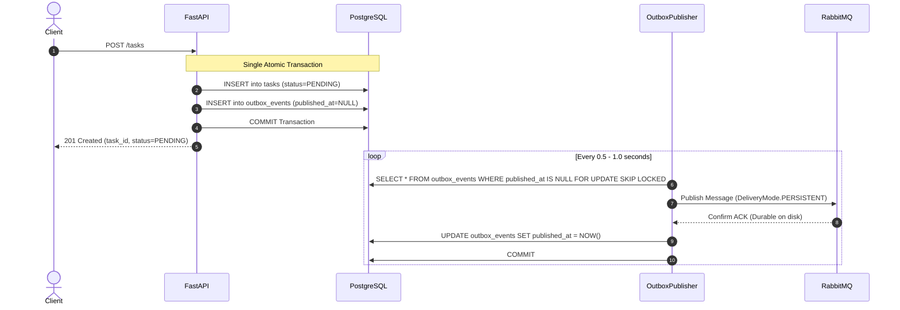

# 03 - Transactional Outbox Pattern

## 1. What Problem This Module Solves: The Dual-Write Problem
When an API receives a task, it must perform two actions:
1. Save the task record in PostgreSQL.
2. Publish a message to RabbitMQ.

In distributed systems, **dual-writes across two independent storage systems cannot be performed atomically without distributed transactions (2PC)**:
- **Scenario A (DB first, then Broker)**: The API writes to PostgreSQL and commits. Before it can publish to RabbitMQ, the API process crashes, power is lost, or the network to RabbitMQ drops. Result: The task is saved in PostgreSQL as `PENDING`, but the broker never gets the message. The task is **silently lost and never runs**.
- **Scenario B (Broker first, then DB)**: The API publishes to RabbitMQ first. Then, the database commit fails (e.g. connection pool exhausted or constraint violation). Result: A worker consumes the message from RabbitMQ, queries PostgreSQL for the task ID, finds nothing, and **crashes or throws phantom task errors**.

## 2. How the Transactional Outbox Solves This
Instead of publishing directly to RabbitMQ during the HTTP request:
1. The API writes both the `Task` entity and an `OutboxEvent` record into **the same PostgreSQL database transaction**.
2. If the transaction commits, both records are guaranteed to exist on disk. If it rolls back, neither exists.
3. An independent asynchronous daemon (`OutboxPublisher`) continuously polls pending outbox events.
4. The publisher dispatches each message to RabbitMQ with **Publisher Confirms** enabled.
5. Once RabbitMQ acknowledges durable disk persistence, the publisher marks the outbox event as `published_at = utc_now()`.

## 3. Key Classes and Implementation
- `OutboxEvent` ([src/taskqueue/models/outbox.py](file:///c:/Users/bhanu/Music/Complete%20Desktop/Distributed_sysstem_project/src/taskqueue/models/outbox.py)):
  - Fields: `id`, `task_id`, `event_type`, `payload`, `routing_key`, `priority`, `created_at`, `published_at`, `locked_until`, `publish_attempts`, `last_error`.
- `OutboxPublisher` ([src/taskqueue/outbox/publisher.py](file:///c:/Users/bhanu/Music/Complete%20Desktop/Distributed_sysstem_project/src/taskqueue/outbox/publisher.py)):
  - `publish_pending_events()`: Fetches pending events, locks them with a lease (`locked_until`), publishes with confirms, and marks `published_at`.

## 4. Failure Modes and Guarantees
- **Broker Downtime**: If RabbitMQ is offline, events accumulate safely in `outbox_events`. When RabbitMQ recovers, the publisher drains the backlog without dropping any tasks.
- **Publisher Crash**: If the publisher crashes after publishing to RabbitMQ but before marking `published_at`, the event lock (`locked_until`) will expire. The next publisher run will re-publish the event.
  - **Guarantee**: **At-least-once delivery**. Consumers must therefore be idempotent.

## 5. Relevant Tests
- [tests/integration/test_outbox_publisher.py](file:///c:/Users/bhanu/Music/Complete%20Desktop/Distributed_sysstem_project/tests/integration/test_outbox_publisher.py): Tests successful publishing, publisher confirm tracking, and graceful recovery during broker failures.

